**To add a key, run** `stuntkey get` followed by the service name, for example `github` (for any other site: `stuntkey get example.com`). Not installed yet? See *Start here* below.

# stuntkey

**Keep your API keys out of your coding agent's context.** The key never enters the
agent's environment when used through the broker, and a hook (Claude Code; newer, undertested ones for Codex and Cursor)
blocks common leaks.

Secretless credential brokering for AI coding agents, plus a scanner for keys
that have already leaked into the files your agent reads.

### Measured, not asserted

The benchmark now lives in its own repo, [keycanary](https://github.com/calasdan-sketch/keycanary), so it is not owned by one tool; `leakbench/` here is a frozen mirror of its probes that this repo's tests use, and StuntKey is one profile there. Its author is StuntKey's author, so it is not a neutral third party, and no rival tool has been scored yet. `leakbench` is a benchmark of 64 ways an AI coding agent leaks a
credential - reading `.env`, dumping the environment, printing a traceback,
following an injected instruction. Run it yourself from a clone of this repository (it is not part of the `pip install` package): `git clone https://github.com/calasdan-sketch/stuntkey && cd stuntkey && python -m leakbench --profile stuntkey-hook` (the default profile, `none`, is the unprotected baseline).

| Protection | blocked | masked | leaked | n/a | total |
|---|---|---|---|---|---|
| nothing | 0 | 0 | **57** | 7 | 64 |
| stuntkey hook | **56** | 6 | **2** | 0 | 64 |
| stuntkey hook + spending caps | **58** | 6 | **0** | 0 | 64 |

(Measured 2026-11-15 with `python -m leakbench --profile none | stuntkey-hook | stuntkey-full --json`, one run each, simulated tool calls rather than a real model. "n/a" means the call could not be reproduced on that machine (a tool missing, a daemon down), so it is neither a pass nor a fail and every row adds up to 64. A different machine, run or version can differ by a probe or two. The same numbers, with the probe names, are in `leakbench/README.md`.)

**The 2 the hook alone does not stop**, named rather than hidden:
`runaway-loop-no-cap` and `unbounded-retry` - a loop that keeps making paid
calls. The spending caps stop those; the hook cannot.

"Masked" means the secret was scrubbed out of the output (best effort), not that the leak was prevented. The The full hook is **Claude Code**. Codex and Cursor have a newer hook built from their documentation and not yet run inside those apps (see below); Gemini and Claude Desktop have none, so none of these numbers apply to them.

`leaked=0` reflects what the hook masks: Bash, PowerShell and MCP tool output. Read and Grep (content mode) output is masked only in a format reported by third parties, not documented by Claude Code and **not yet tested live by us** (pinned Claude Code version: unverified); Monitor output is not masked. A hook that crashes or runs past its time allowance cannot hold output back: Claude Code then shows the original output (PostToolUse is fail-open).

The benchmark's secret is a *registered* key (stuntkey is told about it first, like a key you saved), which flatters the score. With a key stuntkey has never seen (`--profile stuntkey-hook-unregistered`), the same run scores 50 blocked / 12 masked / 2 leaked / 0 n/a (64) when the fake key still looks like a key, and 49 blocked / 6 masked / **7 leaked** / 2 n/a (64) when it has no recognisable format (`--canary opaque`): a key stuntkey was never given and cannot recognise by its shape is found only by what the hook blocks up front (see `leakbench/README.md`).

Zero on this benchmark is not zero everywhere. The hook now reads code before
it is saved and blocks obvious leaks (`print(os.environ)`,
`console.log(process.env)`, opening `.env`). A script that hides what it does
can still get past that check: code-based leaking cannot be fully stopped by patterns.

**Honest limits, in plain words:**
- Windows Credential Manager (and the macOS and Linux keychains) can be read by any program running as you. The keychain keeps keys from other users and machines, not from your own programs.
- The full hook is for Claude Code. Codex and Cursor have a newer, undertested one (built from their documentation, not yet run in those apps; Cursor cannot hide a file read's output at all). Gemini and Claude Desktop file tools have no hook, so their file reads are not checked.
- Screenshots and the clipboard are not covered.
- A brokered call hides the key from the agent; it cannot stop an agent misusing a key it is allowed to use.

Threat model: [docs/THREAT_MODEL.md](docs/THREAT_MODEL.md). Known gaps and
limits: [SECURITY.md](SECURITY.md) - including that stuntkey has not had a paid
external security review, and what we do instead.

- The key sits in your computer's own keychain. When your AI needs an API, it asks stuntkey to make the call, and stuntkey adds the key itself.
- Replies are scrubbed of the key (best effort). In a brokered call, anything other than a read (GET) waits for your click. Every call is logged.
- Plain Python, no extra packages. No account, no server, no cloud.
- Formerly OathKey (and before that SafeEasyAPI).
- Home page and docs: https://calasautomations.com/devtools/stuntkey/



## Start here

pipx is a small helper that installs a Python program on its own, so its command (`stuntkey`) works from any folder. If `pipx` is not on your computer yet, install Python 3.10 or newer from python.org, then run these two lines (on Mac or Linux use `python3` in place of `py`), and open a new terminal window:

```
py -m pip install --user pipx
pipx ensurepath
```

Need pipx? https://pipx.pypa.io

```
pipx install stuntkey
stuntkey setup                 # 1. one yes: finds loose keys, moves them into your keychain, switches the protection on, tests it
stuntkey get github            # 2. adds a key: opens the key page, you click Copy; stuntkey tests the key and saves it
                               # 3. close and reopen your AI app, then ask it: "Who am I on GitHub?"
```

Want to practise first? `stuntkey try` uses a pretend key and touches nothing real. Check it any time with `stuntkey test`; `stuntkey status` shows green, yellow or red for each part and what to do about any that is not green. That is the whole path; the rest of this page explains the pieces.

More on the same path: `stuntkey setup` finds keys lying around in your project, moves them into the keychain, switches everything on, asks once, and checks the result. Then `stuntkey get` (no name) shows a short menu of everyday services, and `stuntkey test` proves it works without touching a real service. `stuntkey install --dry-run` shows which AI-app files it would change and changes nothing. Changed your mind? `stuntkey undo` takes back the last change. `stuntkey help` shows the eight everyday commands; `stuntkey help --all` lists every command. How it compares with 1Password, Infisical and Doppler: see the Compare page in `docs/site/compare.html`. The longer way, step by step: three commands do the whole setup. `stuntkey fix` lists what it will change, asks once, backs up every file it touches, and checks again. It also repairs the usual breakage later (for example after an upgrade moves the program), so if something stops working, run `stuntkey status`, then `stuntkey fix`. `stuntkey help` lists every command grouped by what you want to do, `stuntkey limits` lists what stuntkey does not protect you from, and `stuntkey uninstall` undoes the setup (your saved keys stay). `stuntkey update-check` says which version you have; it looks online only if you add `--online`. To get Tab completion in PowerShell: `stuntkey completion powershell`.

If you prefer the single steps: `stuntkey install` (AI apps) and `stuntkey hook install` (Claude Code's safety check) do the same one at a time.

The hook stops the agent running `stuntkey run`; you start your app yourself with `stuntkey run <svc> -- <your command>`.

Run `stuntkey install` in your project folder. Claude Code and VS Code are set up per folder (`.mcp.json`, `.vscode/mcp.json`); Claude Desktop and Cursor are set up once for all projects.

When a key page asks which permissions to give, pick read-only or the minimum it offers.

Now ask your AI: *"Who am I on GitHub?"* The AI asks stuntkey for `GET /user`; stuntkey makes the call with your key and hands back only the answer. The first time, a window asks you to allow GitHub reads for this session. To see what it did: `stuntkey audit show`.

Restart the AI app after `install`, then ask. A window titled "stuntkey - permission needed" appears; click Yes for reads like `GET /user`, and read the full request before approving anything that changes data. See [The permission windows](#the-permission-windows).

> No `pipx`? `pip install stuntkey` works too. Or download `stuntkey.pyz` from the latest release and run `python stuntkey.pyz doctor`. Latest unreleased code: `pipx install git+https://github.com/calasdan-sketch/stuntkey`.
> Needs Python 3.10 or newer. On Linux the keychain needs `secret-tool` (package `libsecret-tools`). If your computer says `stuntkey` is not found, close the window and open a new one, or run `python -m stuntkey`.

## When your AI writes normal code

Asking stuntkey to make a call works when the AI talks to stuntkey (through MCP or `serve`). If instead your AI writes an ordinary program that uses a vendor's SDK (for example `openai.OpenAI()` reading `OPENAI_API_KEY`), run that program through the proxy:

```
stuntkey proxy -- python app.py
```

The program gets `OPENAI_BASE_URL`, `ANTHROPIC_BASE_URL`, `GROQ_BASE_URL` and `TOGETHER_BASE_URL` pointing at a local stuntkey address on this computer, and its `*_API_KEY` is a throwaway password for that address, not your key. stuntkey adds the real key on the way out and scrubs it from the answers. If stuntkey stops, the program's calls fail instead of going out on their own. `--print-env` prints the variables for a tool you start yourself. There is no certificate trickery: this works only for SDKs that let you change their base address (OpenAI, Anthropic, Groq, Together); other vendors stay on brokered calls. Proxy mode does **not** ask for a click per AI call, unlike a brokered call: a chat prompt is far too long for anyone to read in a confirmation window. Instead it sends `POST` only to the usual AI endpoints (chat, responses, messages, embeddings) and refuses every other write unless an `stuntkey.policy` file you approved allows it. From 0.9.3, a read (GET) to anything that is not an AI endpoint asks you once per service, like a brokered call, and a refused request counts toward the three-refusals stop (it used to go through without asking). A write you allowed by policy asks every time. Streamed answers get the key-scrubber but not the whole-body disguise check a brokered call adds.

For other programs, `stuntkey run openai -- python app.py` puts the key in that one program's environment only and scrubs it from the program's output. That program does see the key, so use `run` yourself; do not hand it to an AI that can run shell commands.

## The permission windows

stuntkey asks you, not the AI, before anything risky. The question appears in a window from your operating system (outside the AI app, so the AI cannot type the answer):

- **Windows:** a standard message box titled "stuntkey - permission needed". No is the default button.
- **macOS:** a system dialog. **Linux:** a `zenity` or `kdialog` window, if one is installed in a system folder.
- **When it asks:** the first read of each service in an AI session (one yes covers that service's reads until the AI app restarts), and every write, change or delete (each one, showing the method, address, query and whole body).
- **No answer** in 2 minutes counts as no. Three refusals stop further requests for that session.
- **No window possible** (SSH, WSL or Linux without a desktop, a headless server): stuntkey asks on the terminal instead and you type a 4-digit code shown only there. If there is no terminal either, or a window helper is installed but cannot open, the answer is no. On WSL a window works only if WSLg (or another display) and `zenity`/`kdialog` are set up.
- **Agent key capture** (`capture_key`, below) asks in its own window, which says it closes by itself after 5 minutes. With no window possible, it relies on a grant you made in the terminal with `stuntkey allow-agent <service>`.

## Why not just put the key in a `.env` file?

AI coding tools read files in your project, and they paste what they read into a chat that someone else's computer sees. A key in a file, a chat or a config can leak in seconds. With stuntkey the key stays in your computer's keychain and stuntkey adds it to each request, so the AI does not receive it through stuntkey. `stuntkey get` will not leave a key in a file in your project folder unless you agree to the fallback (it asks first, and only when no keychain works).

## How it works

1. **You save a key once** (`stuntkey get <service>`). It goes into the Windows, Mac or Linux keychain. stuntkey tests it with a harmless call first.
2. **Your AI asks for an action**, not a key: "GET /user on GitHub". It can only name the service, the method, the path and the data.
3. **stuntkey makes the call itself**, to the service's real address only, adds the key, and hands back the answer with the key scrubbed out.

`stuntkey call` is you making the same brokered call by hand, with no AI involved.

## What stuntkey does not do

It reduces risk; it does not remove it, and no independent security review has been done yet.

- **It does not stop an AI misusing a key it is allowed to use.** Once you allow GitHub reads, the AI can read whatever that key can read. Give each key only the permissions it needs, at the provider.
- **It does not protect against malware, or an AI that can run programs as you.** Anything running as your user can read your keychain, edit the log and click the windows. Run risky agents in a separate account or container.
- **It does not hide the data.** Replies from the API go to your AI, and so to the AI company. The key is scrubbed; the rest is not.
- **It does not protect `run`.** A program started with `run` holds the key and can print it.
- **It does not catch every disguise.** Scrubbing is best effort.
- **The Claude Code hook masks Bash, PowerShell and MCP tool output** (documented behaviour). **Read and Grep (content mode) are masked best effort**, in an output shape reported by third parties that is not in Claude Code's own docs and has not been tested live by us (Claude Code version tested: unverified; a wrong shape is silently ignored by Claude Code, so check it yourself live with a fake key before relying on it). Monitor output is not masked. The hook is **fail-open after the call**: if it crashes or takes longer than its time allowance the output is shown as it is. Before the call it refuses Read of private keys, credentials files and files holding a key you stored (the whole file is read, up to 4 million characters; a bigger file in a place keys are kept is refused), and a Grep for the start of a key (`sk-`, `AKIA`, `ghp_` ...) over a place that holds one. A key stuntkey never stored, in a format it does not know, in an ordinary file, still reaches the AI through Read. A script the AI writes is checked when it is saved, for obvious leaks only (printing the environment, opening `.env`); a script that hides what it does is checked only when it runs through Bash. Measured on this repo's benchmark (Windows, this host): with a registered key the hook stops 62 of the 64 attack probes before or after the call (the two it misses are spending loops; hook plus caps stops all 64), but of 20 harmless everyday commands (`ls`, `git status`, `npm test`, `Read .env.example` ...) it allowed all 20 (`env | grep ^PATH` included), and hook plus spending caps is the one profile here that earns a "perfect" (no leaks and nothing wrongly blocked); the hook alone still leaks the two spending loops. Scores per leak are in [leakbench/README.md](https://github.com/calasdan-sketch/stuntkey/blob/main/leakbench/README.md).
- **Codex and Cursor hooks are new, built from those apps' documentation and not yet run inside the real apps.** `stuntkey hook codex-install` and `stuntkey hook cursor-install` show (add `--write` to apply, `--undo` to remove) a hook for each. Codex: a call that would show a key is refused, and an output holding a protected key is hidden whole (Codex cannot redact in place); you must also trust the hook once with `/hooks`. Cursor: **no hook can hide or clean up the output of a shell command, a file read or a search**, so stuntkey can only refuse those before they run; it can withhold a key from an MCP tool's output. On this repo's probes, converted to each app's documented format: the Codex adapter scores the same as the Claude Code hook (56 blocked, 6 masked, 2 leaked of 64), the Cursor adapter 56 blocked and 8 leaked (the 6 that Claude Code masks stay visible). Both adapters answer 'block' if their own check fails or crashes, and refuse arguments they cannot read, because those apps let a call through when a hook fails (a hook that runs past its timeout, or one you have not yet trusted in Codex, is not covered by that). stuntkey also refuses an agent's attempts to edit those apps' hook files or to run its own `hook codex-install` / `cursor-install --write` or `--undo`. Cursor can only withhold a key from a local (stdio) MCP server's output; its docs say a remote MCP server's output cannot be replaced. Hooks are a guardrail, not a wall, in both apps' own words.
- **Windows keeps at most 1280 characters per key.** A longer key is not saved to the Credential Manager (stuntkey says so and keeps it in the `.env` file instead).
- **The clipboard.** `get` empties it right away, but other programs or clipboard-history tools may see the key while it is there.
- **A tamper-evident log, not a tamper-proof one.** The log is chained and signed, so accidents and casual edits show up. Someone running as you could still rewrite it.
- **It sends nothing except the calls you ask for.** No account, no server of ours, no usage reports. The only network use is the calls you make through it, the key tests you run, `find` (a public list on GitHub) and `update-check --online` (pypi.org), each only when you run it. A test keeps the list of files that may touch the network.

The threat model, with links to the code that does each job, is in [docs/THREAT_MODEL.md](https://github.com/calasdan-sketch/stuntkey/blob/main/docs/THREAT_MODEL.md). More known limits (a GET can read other secrets through a vendor's own endpoints, and others) are under "Known limits" in [SECURITY.md](https://github.com/calasdan-sketch/stuntkey/blob/main/SECURITY.md), which is also where to report a security problem privately.

## Check it yourself (don't trust us)

| Command | What it shows |
|---|---|
| `stuntkey selftest` | Runs stuntkey's rules against simulated attacks, using a made-up key and a pretend server: a server that echoes the key in disguise, tricky addresses, names that point inside your network, writes without permission, edits to the log. Prints how many it stopped (`--verbose` lists each) and exits with an error if any gets through. It does not test the live network layer, so treat it as a check of the rules, not a security audit. |
| `stuntkey doctor` | One-paste health check: keychain, activity log, which AI tools it is plugged into, and a quick self-attack run. |
| `stuntkey scan` | Finds API keys lying in your project files and AI-tool settings, including the MCP server configs of Claude Desktop, Claude Code, Cursor, VS Code, Windsurf, Codex, Gemini and Zed (`--no-mcp` skips those). It prints only a shortened form of each key. `--bundle dist/` or `--bundle https://your-app.com` shows secret keys your website ships to every visitor (`VITE_`, `NEXT_PUBLIC_`, `REACT_APP_`, `EXPO_PUBLIC_` and known key formats). |
| `stuntkey scan-git` | Looks through git history for keys; `--staged` checks only what is about to be committed, `--install-hook` blocks such commits. |
| `stuntkey audit verify` | Checks the activity log was not edited, cut short or deleted. If it did not check out, `audit reset` starts a fresh log and keeps the old one. |

stuntkey uses only Python's own standard library, and a test in the repository ([tests/test_stdlib_only.py](https://github.com/calasdan-sketch/stuntkey/blob/main/tests/test_stdlib_only.py)) fails if that ever changes.

## Commands

**Start**

- `get <service>` - one command: opens the key page, takes the key when you click Copy (then empties the clipboard), tests it, saves it in the keychain. If you are slow, it keeps waiting by itself (3 rounds of 3 minutes, with a countdown line and a message at each new round) - you do not have to run it again. Ctrl-C stops it at any time. In a window that cannot take typing it tells you to use a normal terminal window. `--no-clipboard` uses hidden typing instead; `--no-browser` does not open the page. `--key-from-stdin` is for scripts and tests only: it reads the key from a pipe and refuses to run at a terminal. Any site works too: `stuntkey get example.com` saves the key untested (stuntkey does not know that site's API yet; `stuntkey add` teaches it).
- `try` - a practice run (add, use, forget) with a pretend key, in a throwaway store; nothing real is touched. `--auto` skips the pauses.
- `import <file>` - move keys you already have (a `.env` file, a Doppler or Bitwarden JSON export, a 1Password or Bitwarden CSV export) into the keychain. It shows only the names, asks first, and then tells you to delete the file (`--delete-source` does that for you). `--paste` takes pasted `NAME=value` lines instead of a file.
- `fix` - repair the usual problems by itself (safety check missing, program moved after an upgrade, AI app not plugged in), or switch everything on the first time. Asks once; backs up first. `doctor --fix` is the same after the health check; `--yes` skips the question.
- `status` - one screen: green, yellow or red for the safety check, the AI apps, the keychain, the activity log and the web page's port, each with one next step. In a project folder it also lists the project's keys.
- `help` - every command, grouped by what you want to do. `limits` - what stuntkey does not protect you from. `update-check` - your version (`--online` asks pypi.org for the newest). `completion powershell|bash` - Tab completion.
- `install` / `uninstall` - plug stuntkey into (or remove it from) Claude Desktop, Cursor, Claude Code and VS Code. `uninstall` also takes the Claude Code safety check out of `~/.claude/settings.json` (other hooks stay; `--keep-hook` leaves it) and keeps a backup of every file it changes.
- `doctor` - the health check above. `doctor --self` instead checks that the installed stuntkey files are unchanged since you installed them.
- `start` - a short guided tour: what is connected and what to do next.
- `start --simple` - for apps made with Lovable, Bolt, Replit or Vercel: one plain question at a time. It gets your key, shows where to paste it in your host's secret settings (never in a `VITE_` or `NEXT_PUBLIC_` setting), then checks your live site does not hand the key to visitors.
- `list` - the services it knows.

**Daily**

- `call <service> <METHOD> <path>` - make one brokered call yourself (`--query name=value`, `--data '{...}'`, `--json`). Try `stuntkey call github GET /user`.
- `overview` - what is connected and whether the activity log is intact. (`status` shows where each key lives and how old it is.)
- `audit show` - the last calls, with a warning if the log does not check out.
- `rotate <service>` - replace a stored key.
- `panic <service> [--dry-run]` - "I leaked a key": asks first, revokes it (GitHub and Vercel through their official API; others open the revoke page and wait for you), gets a new one with the `get` flow, then shows where the old key is still written (project, .env, MCP configs, git history). Terminal only - never offered to an agent.
- `proxy [--ttl 30m] [--max-calls N]` - the local proxy hands out short-lived placeholder tokens (`sk_ph_<service>_...`); a session lasts 8 hours by default (`--ttl` takes 90s, 30m, 2h or 1d; 0 means no limit) and can be capped at N calls. `sessions` lists live sessions and `revoke` ends one (or all) at once.
- `caps set openai --calls-day 500 --tokens-day 200000 --calls-session 100` (also `--calls-hour`) - a spending limit per key, counted across every program using it (`--clear` removes it; `caps show` lists them). The limit can be passed by one call already in flight.
- `stop` / `resume` - a kill switch: `stop` refuses every brokered and proxied call at once; `resume` (asks you first) lets them through again.
- `policy show` / `policy approve` - an `stuntkey.policy` file lists the methods and paths each service may use. A project's file can only narrow your own. A new or changed file is obeyed only after you approve it.
- `forget <service>` - remove a stored key (asks first; `--yes` skips the question, and is needed outside a terminal).

**Security**

- `stuntkey verify [--json]` - proves on your own computer that the rules hold, using its own copy of stuntkey and a pretend server, a made-up key and a throwaway folder: it refuses a stranger, never shows the key and fails safe. It has not been run against a live Claude, and it touches none of your real keys.
- `stuntkey explain [--since 7d]` - the last week in plain sentences: which keys were used, what was refused, what the spending limits or kill switch did, and keys not used for 30 days. It reads the activity log, so it only knows what the log recorded.
- `stuntkey age [--warn 90]` - lists keys older than 90 days (set `STUNTKEY_AGE_WARN` to change the number). The age comes from when stuntkey saved or rotated the key; a key it did not save is not counted. `status` shows "N keys older than 90 days". It always exits 0.
- `stuntkey clean-env [--yes] [--dry-run]` - removes plaintext copies of keys from `.env` once they are safely in the keychain. Setup offers it once. The old file is kept in a private backup under `~/.stuntkey/undo`, not next to the project, and the command prints how to undo it.
- `stuntkey scan --agent-configs` - looks for keys written into AI app settings (`.mcp.json`, `.claude`, `.cursor`, `.codex`, `.gemini` in the project and your home folder). It skips files over 1 MB and says which. With `--json` it prints only this result.
- `status --fix` fixes what `status` lists, asking first (`--yes` skips the question). `resume --yes` skips the question only at a real terminal. When a call waits for your permission window, stuntkey says so in the terminal and says how long it waits.
- `selftest`, `doctor`, `scan`, `scan-git`, `hook` (stops Claude Code reading `.env` files and running stuntkey commands that use a key; it blocks the call if it breaks, unless you install it with `hook install --fail-open`) as above.

**Advanced**

- `run <service> -- <command>` - run a program with the key in its environment (see "When your AI writes normal code"). For you, not for an AI with a shell.
- `serve` - a local web door for AI tools that cannot use MCP (OpenAI-style functions, Ollama, scripts).
- `mcp` - the MCP server your AI app starts for you. Besides brokered calls it has `capture_key`: your AI opens the key page, you click Copy, and stuntkey takes the key from the clipboard without passing it to the AI. You allow this per service with `allow-agent <service>`.
- `init` / `setup` - write `stuntkey.json` for a project, then connect every service it needs.
- `remote`, `trust-server`, `deploy` - use a key on your own server over ssh.
- `wrap <client> <server>` - move a key out of an MCP server's settings into the keychain; the server is then started through `stuntkey run`. `--all --dry-run` previews every server, `--undo` puts that server's old entry back (the rest of the file stays as it is), `--file` picks a config file.
- `proxy -- <command>` - see "When your AI writes normal code".
- `add` - make your own service recipe. `find` - look for free public APIs.

Coming from `oathkey` (0.8)? The first run copies `~/.oathkey` to `~/.stuntkey` (the old folder stays), old `oathkey.json` / `oathkey.policy` files are still read, and `stuntkey doctor` points at what is left: `stuntkey migrate` copies saved keychain keys to the new names and reads each one back (add `--remove-old` to then delete the old entries), and `stuntkey install` / `stuntkey hook install` replace old `oathkey` hook and MCP entries after showing the change and asking (`hook install --yes` skips the question). Coming from the older `safeeasyapi` name? Nothing is migrated from it: re-run `stuntkey get <service>` and `stuntkey install`, and remove any old `safeeasyapi` hook or MCP entry by hand.

Many commands accept `--json` (try `list`, `overview`, `selftest`, `doctor`, `audit`, `status`, `test`, `fix`; the JSON of `status`, `test` and `fix` carries `"schema": 1`). Exit codes: 0 fine, 1 problem, 2 wrong usage, 3 service not found, 5 refused by policy, 7 network problem. `stuntkey test` exits 1 on FAIL; `stuntkey status` exits 1 when a computer that was set up now needs attention (a computer never set up is told to run `stuntkey setup` and exits 0).

## Services

37 services are built in, from GitHub and Stripe to OpenAI and AWS. `stuntkey list` shows them all.

Not listed? `stuntkey add` makes a recipe in a minute. A recipe cannot send a built-in service's key to a different server. To share a recipe with everyone, see [CONTRIBUTING.md](https://github.com/calasdan-sketch/stuntkey/blob/main/CONTRIBUTING.md).

The longer user guide (every flag, where keys are stored, two-value keys, testing) is in [docs/guide.md](https://github.com/calasdan-sketch/stuntkey/blob/main/docs/guide.md).

## License

MIT, no warranty. See [LICENSE](https://github.com/calasdan-sketch/stuntkey/blob/main/LICENSE).
